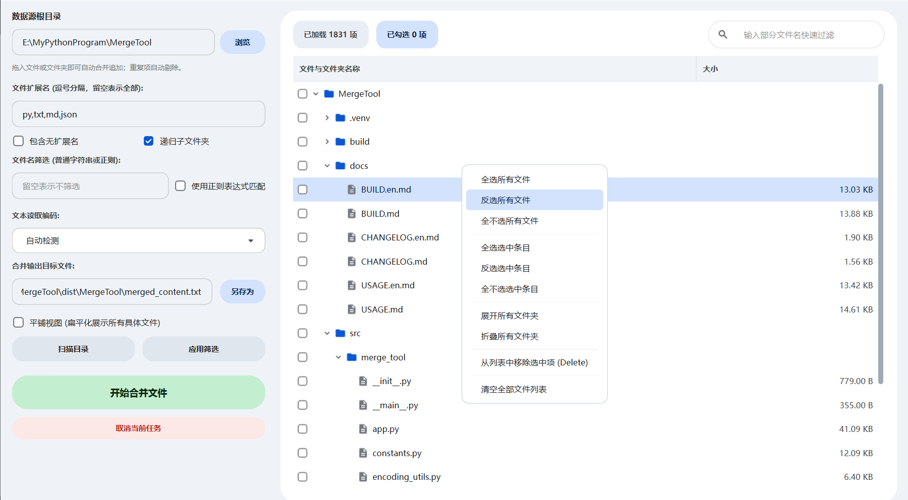

<!-- Language switch: Chinese | English (current) -->
[简体中文](README.md) | **English**

---

# MergeTool · File Content Merger

> A graphical file content merger built with **PySide6 + Google Material Design 3**.
> It supports a tri-state checkbox directory tree, flat/tree dual view, regex filtering,
> drag & drop loading, and robust multi-encoding auto-detection — merging hundreds of
> text files into a single metadata-rich report.


---

## 📖 Documentation

| Document | Description |
| --- | --- |
| [📘 Usage Guide](docs/USAGE.en.md) | For end users: installation, UI walkthrough, full workflow, FAQ |
| [🛠 Build & Packaging](docs/BUILD.en.md) | For developers: environment setup, dependency management, debugging, PyInstaller packaging, size optimization |
| [📝 Changelog](docs/CHANGELOG.en.md) | Version history |

> Chinese users: click [简体中文](README.md) at the top to switch back.

---

## ✨ Features

- **Tri-state directory tree**: folders aggregate into checked / partial / unchecked with parent-child cascade.
- **Dual view modes**: switch between hierarchical tree and flat file list with one click.
- **Powerful filtering**:
  - Filter by extensions (e.g. `py,txt,md,json`; leave empty for all).
  - Include / exclude files without extensions.
  - Recursive / non-recursive subfolder traversal.
  - Filename filter supporting plain strings or **regular expressions**.
- **Drag & drop**: drop files or folders onto the window to load them, with automatic de-duplication and appending.
- **Robust multi-encoding detection**:
  - BOM detection → chardet sampling (with confidence threshold + strict re-decode verification) → strict UTF-8 probe → strict GB18030 probe → latin-1 fallback.
  - Correctly detects GBK/GB2312 files without BOM, common in legacy Chinese projects.
- **High-performance background threads**: scanning and merging run off the UI thread; UI never freezes and tasks can be cancelled.
- **Google Material Design 3 UI**: official Material Symbols vector icons, M3 palette, pill-shaped inputs, rounded menus without artifacts.
- **Metadata-rich output**: generation time, root directory, file count, encoding mode, filter conditions, plus absolute path / encoding / size per file.

---

## 🖼 Interface Preview



> The left side is the data source, filtering, and output configuration area; the right side is the file tree and context menu.

---

## 🚀 Quick Start

### Option 1: Run from source (recommended for developers)

```powershell
git clone https://github.com/liufeias/MergeTool.git
cd MergeTool

# Install dependencies with uv (recommended)
uv sync

# Run
uv run python -m merge_tool
# or
uv run merge-tool
```

### Option 2: Use the prebuilt exe (recommended for end users)

Download `MergeTool-vX.Y.Z.zip` from the [Releases](https://github.com/liufeias/MergeTool/releases) page,
extract it, and double-click `MergeTool.exe`. **No Python installation required.**

> See the [📘 Usage Guide](docs/USAGE.en.md) for detailed steps.

---

## 🗂 Project Structure

```
MergeTool/
├── src/merge_tool/          # Source package
│   ├── __init__.py          # Package entry & version
│   ├── __main__.py          # Entry for `python -m merge_tool`
│   ├── app.py               # Main window & UI orchestration
│   ├── constants.py         # Global constants, M3 palette, SVG icons, QSS theme
│   ├── encoding_utils.py    # Encoding detection & safe reading
│   ├── file_utils.py        # File-system helpers
│   ├── tree_model.py        # Tree data model (tri-state, cascade)
│   ├── tree_view.py         # Tree widget wrapper (custom delegate)
│   └── workers.py           # Background workers (scan & merge)
├── assets/                  # Icons and static resources (optional)
├── docs/                    # Documentation
├── pyproject.toml           # Project metadata & deps (PEP 621)
├── uv.lock                  # uv lockfile
├── MergeTool.spec           # PyInstaller spec
└── README.en.md             # This file
```

---

## 🧭 Cross Links

- 中文：[使用帮助](docs/USAGE.md) · [开发构建打包](docs/BUILD.md) · [更新日志](docs/CHANGELOG.md)
- English: [Usage](docs/USAGE.en.md) · [Build](docs/BUILD.en.md) · [Changelog](docs/CHANGELOG.en.md)

---

## 📄 License

Released under the [MIT License](LICENSE).

## 🙏 Credits

- [PySide6](https://doc.qt.io/qtforpython/) — official Qt for Python bindings
- [chardet](https://github.com/chardet/chardet) — universal character encoding detector
- [Google Material Design 3](https://m3.material.io/) — design language reference